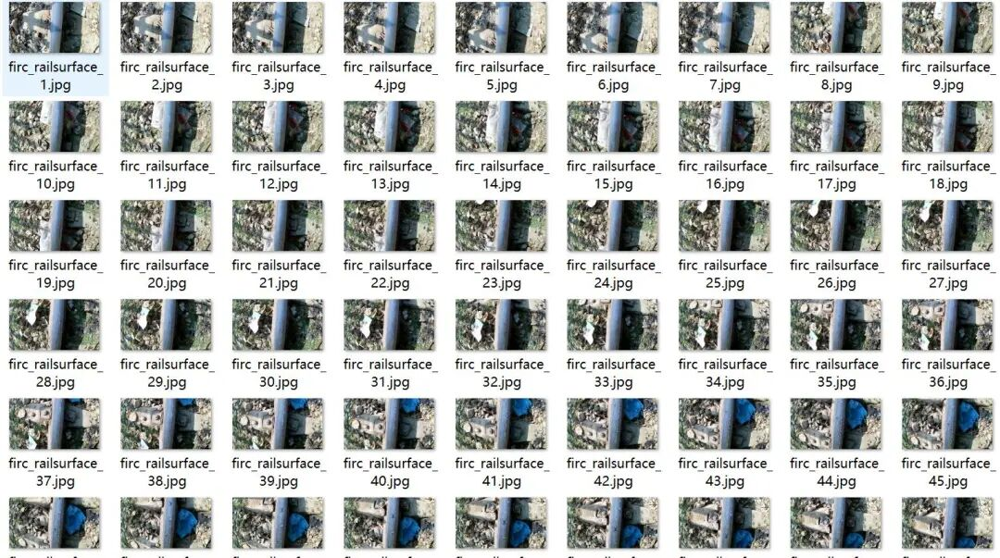
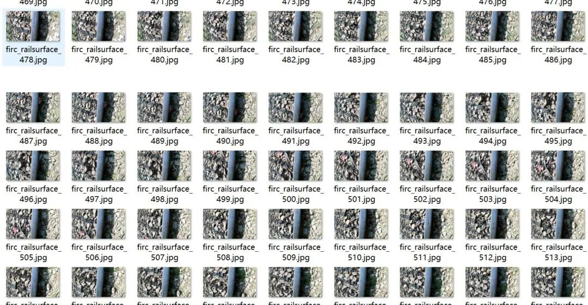
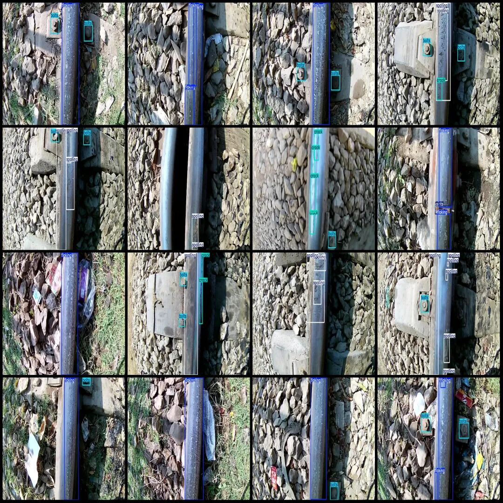
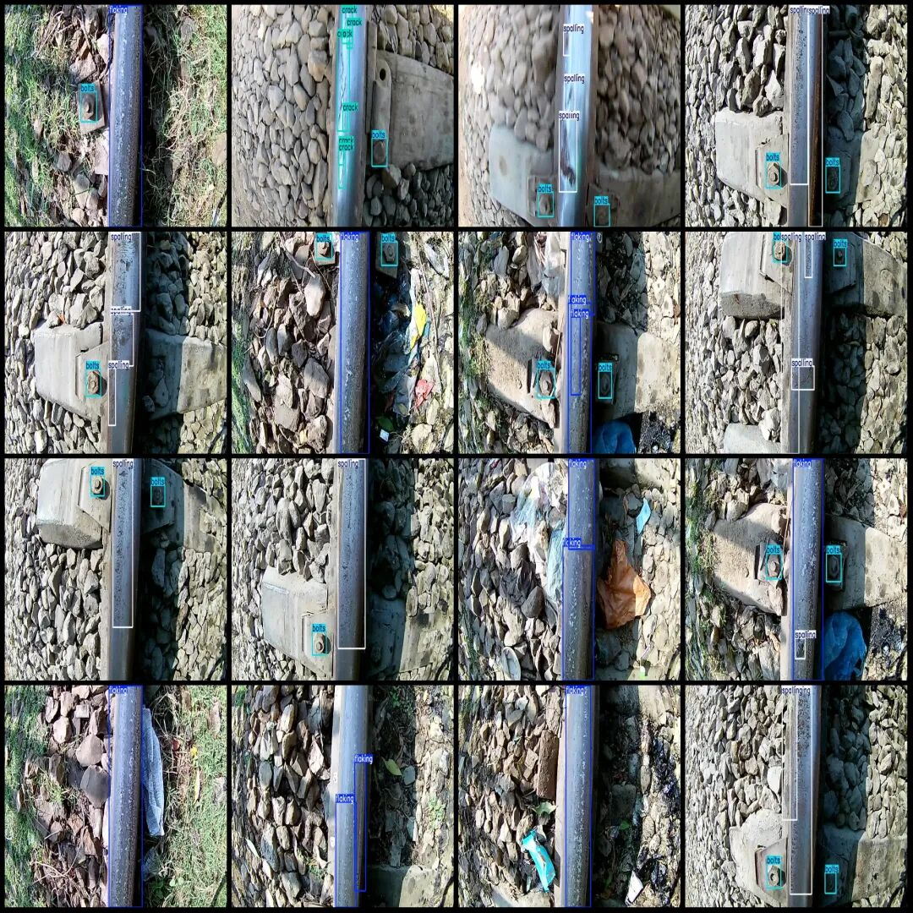

# Intelligent Railway Inspection Data Set for Track Defect Detection in VOC+YOLO format with 909 images across 5 categories

Dataset format: Pascal VOC format + YOLO format (txt file without split path, only containing jpg images and corresponding VOC format xml files and yolo format txt files)

Number of images (number of jpg files): 909

Number of annotations (number of xml files): 909

Number of annotations (number of txt files): 909

Label category count: 5

Label category names (Note: the order of Yolo format categories does not correspond to this, but is based on the labels folder's classes.txt): ["bolts", "crack", "flaking", "joints", "spalling"]

Number of boxes labeled in each category:

Bolts (Plugs) Frame Count = 877

Crack (fragment) count = 133

Flaking (peeling) frame count = 1039

Number of joints (nodes) = 24

Spalling (peeling) frame count = 525

Total frame count: 2598

Image resolution: 1280x720

Using labelImg:

Annotation rules: Draw a rectangle around the category.

Important Notice: The dataset does not have separate training, validation, and test sets; you need to partition them yourself.

Special : This dataset does not guarantee the accuracy of the trained models or weight files.

Image Preview:

Annotation example:

## Payment

Here is a pay link on Stripe ( https://buy.stripe.com/3cs8yP7sY87d0vu9AB ). Please contact me lonlonago@foxmail.com after funding $89, and I will send you a complete data files , thank you!

